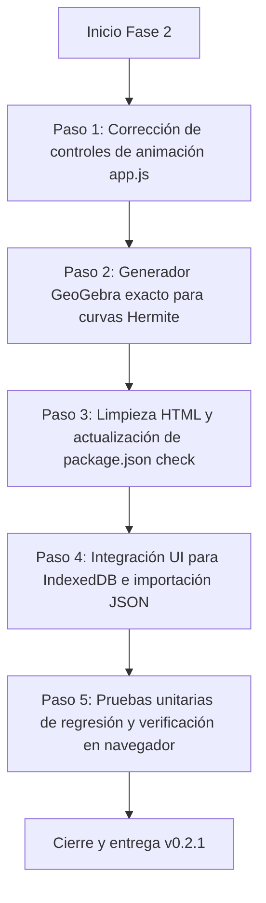

# INFORME DE AUDITORÍA TÉCNICA
# SIMULADOR DE LLENADO DE RECIPIENTES + ENTORNO LINUX MINT / VS CODE

**Fecha de auditoría:** 27 de octubre de 2026  
**Equipo auditor:** Equipo de Ingeniería de Software (Agente Auditor de Código, Agente QA & Pruebas, Agente Linux & Escritorio, Agente Coordinador)  
**Proyecto:** Simulador de Llenado de Recipientes Prismáticos Extruidos (`simulacion-de-llenado`)  
**Versión declarada:** v0.2.0 (código) / 0.1.0 (`package.json`)  
**Entorno de referencia:** Linux Mint (XFCE), Acer Aspire A515-43 (8 GB RAM, AMD Radeon Vega 3), VS Code  

---

## 1. Resumen Ejecutivo

Se ha completado la **Fase 1 (Auditoría Técnica Estricta)** sobre el repositorio del proyecto *Simulador de Llenado* y su interacción con el entorno de trabajo en Linux Mint. La auditoría se ha llevado a cabo de forma estrictamente pasiva: **no se ha modificado ningún archivo de código del simulador, no se han instalado paquetes y no se han alterado configuraciones del sistema**.

### Principales conclusiones:
1. **Núcleo matemático y físico robusto:** El motor geométrico (`src/geometry/profile.js`) y físico (`src/physics/model.js`) aprueba el 100% de las pruebas automatizadas (10/10). La integración exacta de polinomios para tramos lineales y curvas Hermite, el cálculo por bisección y la condición de frontera para puntas triangulares ($w=0$ en base o boca) funcionan con rigor analítico.
2. **Defectos funcionales identificados en la UI:**
   - **Bucle de animación duplicable:** Pulsar el botón `startBtn` repetidamente o cuando muestra el estado de ejecución genera múltiples bucles concurrentes de `requestAnimationFrame`, provocando que el reloj de la simulación se acelere de forma descontrolada.
   - **Discrepancia en exportador GeoGebra:** El módulo `src/ui/formula-viewer.js` ignora las pendientes de las curvas cúbicas Hermite y genera siempre rectas `Curva(m·t + b)` y funciones de área lineales, produciendo discrepancias volumétricas notables (por ejemplo, calcula $0.25\text{ m}^3$ en lugar de los $0.3083\text{ m}^3$ reales del perfil parabólico).
   - **Persistencia IndexedDB desconectada en la UI:** Aunque `src/storage.js` está implementado y probado, la interfaz (`index.html` y `app.js`) carece de controles visuales para guardar, abrir, renombrar y listar en IndexedDB, así como del botón para importar JSON.
   - **Etiquetas HTML huérfanas:** `index.html` contiene etiquetas de cierre huérfanas (`

`) en las líneas 206-207.
3. **Entorno Linux Mint y lanzadores de VS Code:**
   - Los lanzadores `~/.local/share/applications/vscode-unico.desktop` y `~/Escritorio/VS Code - Ventana controlada.desktop` están correctamente configurados, apuntan al script wrapper `/home/zerozta/.local/bin/vscode-unico` y utilizan el icono Papirus existente (`/usr/share/icons/Papirus/64x64/apps/visual-studio-code.svg`).
   - El script gestiona eficazmente las ventanas de VS Code para evitar saturación de memoria en equipos con 8 GB de RAM. No interfiere con el simulador ni genera conflictos.
   - Node.js v24.22.1 está alojado en `~/.nvm/` y requiere declarar `PATH` en scripts no interactivos para ejecutar `npm test`.

**Veredicto global:** **APTO CON OBSERVACIONES** *(Condicionado a la resolución de los defectos de animación, exportación matemática a GeoGebra y sincronización de UI/documentación en la Fase 2)*.

---

## 2. Identificación del Proyecto y Tecnologías

| Parámetro | Detalle |
| :--- | :--- |
| **Nombre del proyecto** | Simulador de Llenado («Llenado») |
| **Tipo de aplicación** | Aplicación Web SPA (Single Page Application) Vanilla 100% Offline |
| **Ubicación en el sistema** | `/home/zerozta/Proyectos/Activos/simulacion-de-llenado` |
| **Punto de entrada** | `index.html` (interfaz) / `src/ui/app.js` (script principal) |
| **Lenguajes** | JavaScript ES6+ (Módulos nativos), HTML5, CSS3, SVG declarativo |
| **Dependencias de producción** | 0 dependencias externas (sin frameworks, sin librerías CDN, sin backend) |
| **Gestor y pruebas** | Node.js Test Runner nativo (`node:test`, `node:assert/strict`) |
| **Almacenamiento** | IndexedDB (motor en `src/storage.js`) y descarga de archivos JSON (Blob) |
| **Compatibilidad** | Navegadores modernos (Firefox, Chrome, Chromium) con soporte para módulos ES y SVG |

---

## 3. Requisitos Confirmados vs. Observables

### A. Requisitos Confirmados (Documentados en `FICHA_TECNICA.md` y `CONTRATO.md`)
1. **Geometría de extrusión prismática 2D:** Perfil bidimensional con profundidad constante $d > 0$ en el Sistema Internacional (SI).
2. **Condición de frontera crítica:** Ancho $w(y) = 0$ admitido exclusivamente en extremos (base $y_{\min}$ o boca $y_{\max}$). En cualquier cota interior debe verificarse $w(y) > 0$.
3. **Leyes de llenado:** Cálculo de volumen acumulado $V(h) = \int_{y_{\min}}^h A(y) dy$, rapidez $\frac{dh}{dt} = \frac{Q}{A(h)}$ y cálculo numérico inverso de altura $h(V)$ por bisección acotada.
4. **Interfaz de cuatro paneles:**
   - Panel 1: Plano Cartesiano interactivo (escala fija, simetría, snap a cuadrícula, vértices arrastrables).
   - Panel 2: Vista limpia del recipiente físico sin cuadrículas ni vértices de edición.
   - Panel 3: Deducción de fórmulas analíticas y exportador para GeoGebra.
   - Panel 4: Gráficas analíticas en tiempo real ($h(t)$, $V(t)$, $A(y)$, $w(y)$).
5. **Autonomía offline:** No depender de conexión a Internet ni de CDNs remotas.

### B. Requisitos Observables Derivados del Código
1. **Control de historial:** Pila de acciones con capacidad de deshacer/rehacer (`undoBtn`, `redoBtn`).
2. **Plantillas preconfiguradas:** Selector con 6 figuras típicas (Rectangular, Triángulo ▽, Triángulo △, Trapecio, Matraz, Copa Hermite).
3. **Control deslizante temporal:** `timeRange` adaptado dinámicamente al tiempo total de llenado estimado.

### C. Requisitos Documentados pero Inconsistentes en la Implementación Actual
1. **Biblioteca local IndexedDB en la UI:** Documentada ampliamente en `MANUAL.md` (guardar por nombre, listar, renombrar, borrar), pero sin interfaz de usuario conectada en `index.html`.
2. **Importador de archivos JSON:** Descrito en `MANUAL.md` e implementado lógicamente en `src/geometry/editor.js` (`importGeometry`), pero sin botón `<input type="file">` ni botón de importación en `index.html`.
3. **Edición por expresiones matemáticas:** `MANUAL.md` describe escribir fórmulas para las paredes; los módulos `parser.js` y `expressions.js` existen y pasan pruebas, pero la UI actual no provee cajas de texto para introducir fórmulas arbitrarias.

---

## 4. Matriz de Cumplimiento

| ID | Requisito / Comportamiento | Estado | Evidencia Concreta | Ubicación | Impacto | Prioridad |
| :---: | :--- | :---: | :--- | :--- | :---: | :---: |
| **REQ-01** | Integración analítica y física de llenado | **CUMPLE** | Cálculo polinómico exacto en tramos rectos y Hermite; 10/10 pruebas unitarias aprobadas. | `src/physics/model.js` | Crítico | — |
| **REQ-02** | Geometría triangular con punta ($w=0$) | **CUMPLE** | Admite base o boca puntual sin desbordamiento de agua en clean-view ni en editor cartesiano. | `src/geometry/profile.js:64-66` | Crítico | — |
| **REQ-03** | Visualización en Vista Limpia (Panel 2) | **CUMPLE** | Renderiza el recipiente con estilo acrílico y menisco de líquido sin ejes. | `src/ui/clean-view.js` | Alto | — |
| **REQ-04** | Modo de Vista Fija y Simetría | **CUMPLE** | Checkboxes `lockViewMode` y `symmetryMode` funcionales; escala y origen estables al arrastrar. | `src/ui/cartesian-editor.js:143-160` | Alto | — |
| **REQ-05** | Gráficas en tiempo real (Panel 4) | **CUMPLE** | Genera curvas SVG nativas para $h(t)$, $V(t)$, $A(y)$ y $w(y)$ sin librerías externas. | `src/ui/charts.js` | Medio | — |
| **REQ-06** | Generador de sintaxis GeoGebra | **CUMPLE PARCIALMENTE** | Genera código para tramos rectos, pero tramos Hermite son degradados a líneas rectas. | `src/ui/formula-viewer.js:83-114` | Alto | Alta |
| **REQ-07** | Control de animación y reloj de simulación | **CUMPLE PARCIALMENTE** | Simula correctamente, pero pulsar `startBtn` en ejecución duplica `requestAnimationFrame`. | `src/ui/app.js:368-374` | Alto | Alta |
| **REQ-08** | Persistencia en IndexedDB | **CUMPLE PARCIALMENTE** | Módulo `storage.js` 100% funcional y probado, pero sin integración visual en la UI. | `src/storage.js`, `index.html` | Medio | Media |
| **REQ-09** | Exportación de diseño en JSON | **CUMPLE** | Botón `exportBtn` genera y descarga archivo JSON versionado válido. | `src/ui/app.js:419-432` | Medio | — |
| **REQ-10** | Importación de diseño JSON en la UI | **NO CUMPLE** | No existe elemento en el DOM ni listener en `app.js` para cargar archivos JSON externos. | `index.html`, `src/ui/app.js` | Medio | Media |
| **REQ-11** | Sintaxis y validación HTML del documento | **NO CUMPLE** | Etiquetas de cierre huérfanas `

` en las líneas 206-207. | `index.html:206-207` | Bajo | Baja |
| **REQ-12** | Chequeo estático de scripts en `package.json` | **CUMPLE PARCIALMENTE** | `npm run check` no incluye 4 submódulos UI recientes (`clean-view`, `formula-viewer`, etc.). | `package.json:8` | Bajo | Baja |
| **REQ-13** | Ejecución local en Linux Mint | **CUMPLE** | Ejecutable mediante servidor HTTP local (`python3 -m http.server 8000`) o extensión VS Code. | `README.md:11` | Crítico | — |
| **REQ-14** | Independencia de lanzadores del sistema | **CUMPLE** | El simulador no depende ni altera los lanzadores de escritorio de VS Code. | Sistema / Lanzadores | Crítico | — |

---

## 5. Resultados de las Pruebas Ejecutadas

### 5.1 Pruebas Unitarias Automatizadas (`npm test`)
- **Comando:** `PATH="/home/zerozta/.nvm/versions/node/v24.22.1/bin:$PATH" npm test`
- **Resultado:** **10 superadas / 0 fallidas** (568 ms).
- **Detalle de casos:**
  1. Perfil extruido: área, capacidad y serialización.
  2. Perfil rechaza anchos no positivos y alturas desalineadas.
  3. Integración, inversión y llenado respetan unidades y capacidad.
  4. Parser evalúa expresiones aritméticas y bloquea sintaxis ejecutable.
  5. Perfil lineal variable coincide con integral trapezoidal y trazos exportan/importan.
  6. Caudal cero mantiene volumen inicial y el parser rechaza división por cero.
  7. Hermite cúbico usa antiderivada exacta y serializa segmentos mixtos.
  8. Perfil Hermite rechaza cruce interior aunque los extremos tengan ancho positivo.
  9. Biblioteca valida contenido antes de acceder a IndexedDB y reporta su ausencia.
  10. Perfil triangular con punta ($w=0$ en extremos) es admitido y calcula volumen correctamente.

### 5.2 Comprobación Sintáctica (`node --check`)
- **Comando del proyecto:** `PATH="..." npm run check` (8 archivos verificados con éxito).
- **Comprobación complementaria:** `node --check src/ui/clean-view.js src/ui/formula-viewer.js src/ui/templates.js src/ui/cartesian-editor.js` (4 archivos adicionales verificados con éxito, sin errores sintácticos).

### 5.3 Verificación de Plantillas Geométricas Preconfiguradas
Se ejecutó un script de prueba no destructivo que instanció las 6 plantillas de `src/ui/templates.js` y las sometió a simulación dinámica de llenado ($t=0$, $t=t_{\text{medio}}$, $t=t_{\text{full}}$, $t=1.5\cdot t_{\text{full}}$):
- `rect` (Cilíndrico / Rectangular): Válido, capacidad = $0.25\text{ m}^3$.
- `triangle_down` (Punta abajo ▽): Válido, capacidad = $0.20\text{ m}^3$.
- `triangle_up` (Punta arriba △): Válido, capacidad = $0.20\text{ m}^3$.
- `trapezoid` (Trapecio / Embudo): Válido, capacidad = $0.30\text{ m}^3$.
- `flask` (Matraz Erlenmeyer): Válido, capacidad = $0.2525\text{ m}^3$.
- `parabolic` (Copa Parabólica Hermite): Válido, capacidad = $0.30833\text{ m}^3$.

### 5.4 Auditoría del Entorno Linux Mint y Lanzadores de Escritorio
- **Archivos verificados:**
  - `~/.local/share/applications/vscode-unico.desktop` (Presente, permisos `rwxrwxr-x`).
  - `~/Escritorio/VS Code - Ventana controlada.desktop` (Presente, permisos `rwxrwxr-x`).
  - `/usr/share/icons/Papirus/64x64/apps/visual-studio-code.svg` (Presente, legible, SVG íntegro de 5307 bytes).
  - `/home/zerozta/.local/bin/vscode-unico` (Presente, script bash con `flock`, `wmctrl` y `zenity`).
- **Resultado:** Ambos lanzadores son sintácticamente válidos conforme a la especificación FreeDesktop y apuntan de forma segura al script controlador de ventanas.

---

## 6. Errores Reproducibles

### ERR-01: Bucle de animación multiplicable por re-pulsación de `startBtn`
- **Ubicación:** [src/ui/app.js](file:///home/zerozta/Proyectos/Activos/simulacion-de-llenado/src/ui/app.js#L368-L374)
- **Descripción:** El listener del botón `startBtn` no comprueba si la simulación ya está corriendo (`running === true`). Al pulsar el botón cuando ya está activo, reinicia `lastFrame = 0` y solicita una nueva llamada a `requestAnimationFrame(frame)`.
- **Reproducción:** Iniciar la simulación y hacer 3 clics rápidos en `startBtn`. La simulación avanza 3 veces más rápido de lo real. Además, el botón cambia su etiqueta a `● Pausar`, pero pulsar en él no pausa la simulación (la pausa la gestiona exclusivamente `pauseBtn`).
- **Impacto:** Desincronización del tiempo real respecto a la física del simulador; frustración del usuario.
- **Prioridad:** **Alta**.

### ERR-02: Exportador GeoGebra linealiza erróneamente curvas Hermite
- **Ubicación:** [src/ui/formula-viewer.js](file:///home/zerozta/Proyectos/Activos/simulacion-de-llenado/src/ui/formula-viewer.js#L83-L114)
- **Descripción:** La función `generateGeoGebraCode` extrae los parámetros de la pared utilizando únicamente `lineParams` (recta $m \cdot y + b$) entre los nudos extremos, omitiendo por completo los coeficientes cúbicos de Hermite y las derivadas `leftSlope` y `rightSlope`.
- **Reproducción:** Cargar la plantilla "Copa parabólica" y copiar el código para GeoGebra. El código genera rectas y una integral que evalúa a $0.25\text{ m}^3$, mientras que el simulador indica $0.30833\text{ m}^3$.
- **Impacto:** Error pedagógico en laboratorio de cálculo: las ecuaciones entregadas al estudiante para GeoGebra no corresponden a la curva visualizada.
- **Prioridad:** **Alta**.

### ERR-03: Estructura HTML con etiquetas de cierre huérfanas
- **Ubicación:** [index.html](file:///home/zerozta/Proyectos/Activos/simulacion-de-llenado/index.html#L206-L207)
- **Descripción:** Existen etiquetas `
` y `
` sin correspondencia con etiquetas de apertura antes del cierre de `</main>`.
- **Reproducción:** Validar la estructura del DOM o inspeccionar las líneas 205-208 de `index.html`.
- **Impacto:** Inconsistencia de sintaxis en el árbol DOM (los navegadores modernos lo ignoran, pero degrada la calidad del código).
- **Prioridad:** **Baja**.

### ERR-04: Omisión en la UI de persistencia IndexedDB e importación JSON
- **Ubicación:** [index.html](file:///home/zerozta/Proyectos/Activos/simulacion-de-llenado/index.html#L26-L34), [src/ui/app.js](file:///home/zerozta/Proyectos/Activos/simulacion-de-llenado/src/ui/app.js#L8)
- **Descripción:** En la refactorización v0.2.0, los botones para guardar, abrir o borrar en IndexedDB y el botón para importar JSON no se incluyeron en el DOM ni se enlazaron con `app.js`, a pesar de que el código de `storage.js` y `editor.js` está completamente probado y funcional.
- **Impacto:** El usuario no puede beneficiarse de la persistencia local documentada en `MANUAL.md`.
- **Prioridad:** **Media**.

---

## 7. Problemas del Entorno

1. **Variables de entorno de Node.js en subshells:**
   - La instalación de Node.js se encuentra gestionada por NVM en `/home/zerozta/.nvm/versions/node/v24.22.1/bin`. En sesiones de terminal no interactivas donde no se carga el script de inicialización de NVM, el comando `npm` o `node` no se encuentra en el `PATH` estándar.
   - *Solución requerida en entorno:* Asegurar que la ruta a los binarios de Node.js esté presente en el `PATH` del perfil del usuario o configurar un enlace simbólico en `/usr/local/bin` si se desea acceso global.
2. **Servidor HTTP para módulos ES6:**
   - Al tratarse de una aplicación web construida con módulos JavaScript nativos (`<script type="module">`), la apertura directa con doble clic mediante el protocolo `file:///` puede verse bloqueada por políticas de seguridad de origen cruzado (CORS) de ciertos navegadores.
   - *Recomendación:* Utilizar la extensión *Live Server* de VS Code o ejecutar en la terminal del proyecto `python3 -m http.server 8000`.

---

## 8. Riesgos No Confirmados

1. **Gestión de eventos táctiles en pantallas táctiles o móviles:**
   - El código implementa captura de punteros (`setPointerCapture`) y soporte para eventos unificados `pointerdown/pointermove/pointerup`. No obstante, la manipulación de vértices con dedos gruesos podría requerir un área de contacto (*hit target*) más generosa (actualmente radio SVG $r=7$).
2. **Consumo de memoria en hardware modesto durante sesiones prolongadas:**
   - En una máquina con 8 GB de RAM y gráficos integrados Vega 3, el renderizado SVG a 60 FPS no supone una sobrecarga apreciable siempre que el bucle de animación no se duplique (ver ERR-01).

---

## 9. Limitaciones de la Auditoría

- La auditoría se ha ceñido a un análisis estático exhaustivo y a pruebas de ejecución seguras sin modificaciones en el disco.
- No se ha utilizado un entorno de pruebas con navegador *headless* automatizado (Puppeteer/Playwright) debido a que no formaba parte de las dependencias instaladas en el equipo.

---

## 10. Recomendaciones Ordenadas por Prioridad

### Prioridad Crítica / Alta:
1. **[REC-01] Corregir la máquina de estados del botón de inicio:**
   Modificar `startBtn` para alternar entre "Iniciar" y "Pausar" cuando se pulse, impidiendo que se invoque `requestAnimationFrame` si la simulación ya está activa.
2. **[REC-02] Incorporar la formulación cúbica en el generador de GeoGebra:**
   Para segmentos con `kind === 'hermite'`, deducir en `generateGeoGebraCode` el polinomio cúbico en $t$:
   $$x(t) = (2x_0 - 2x_1 + m_0 \Delta y + m_1 \Delta y)t^3 + (-3x_0 + 3x_1 - 2m_0 \Delta y - m_1 \Delta y)t^2 + (m_0 \Delta y)t + x_0$$
   y generar la curva correspondiente `Curva(x(t), y(t), t, 0, 1)` junto con la función de área cúbica para GeoGebra.

### Prioridad Media:
3. **[REC-03] Habilitar la interfaz para IndexedDB e Importación JSON:**
   Agregar una sección colapsable o modal ligero en la barra superior con los controles: «Guardar diseño», «Mis diseños guardados», y un botón `<input type="file" accept=".json">` que conecte con `importGeometry`.
4. **[REC-04] Actualizar la documentación técnica y manual:**
   Sincronizar `docs/MANUAL.md` para que describa con precisión los componentes del diseño v0.2.0 (Vista fija, Simetría, Vista limpia, GeoGebra).

### Prioridad Baja:
5. **[REC-05] Limpiar etiquetas huérfanas en `index.html`:**
   Eliminar las líneas 206-207 (`

`).
6. **[REC-06] Completar el script `check` en `package.json`:**
   Añadir los módulos `clean-view.js`, `formula-viewer.js`, `templates.js` y `cartesian-editor.js` al script `"check"`.

---

## 11. Plan de Corrección Propuesto (Fase 2)

1. **Paso 1 (Animación):** Unificar el botón Iniciar/Pausar en `src/ui/app.js` con un interruptor `togglePlayPause()`, cancelando siempre cualquier `raf` previo.
2. **Paso 2 (GeoGebra):** Implementar en `src/ui/formula-viewer.js` la rama de generación polinómica cúbica para segmentos Hermite.
3. **Paso 3 (Sintaxis):** Limpiar etiquetas de cierre en `index.html` y actualizar el comando `"check"` en `package.json`.
4. **Paso 4 (Persistencia):** Añadir panel colapsable de biblioteca en `index.html` conectando los métodos existentes en `src/storage.js`.
5. **Paso 5 (Validación):** Ejecutar `npm test`, `npm run check` y comprobar visualmente en Firefox sirviendo con `python3 -m http.server`.

---

## 12. Registro de Archivos Inspeccionados y Comandos Ejecutados

### Archivos Inspeccionados:
- `package.json`
- `README.md`
- `CHANGELOG.md`
- `FICHA_TECNICA.md`
- `docs/ARQUITECTURA.md`, `docs/CONTRATO.md`, `docs/DECISIONES.md`, `docs/MANUAL.md`, `docs/MODELO_MATEMATICO.md`, `docs/PLAN_MEJORAS.md`, `docs/PRUEBAS.md`, `docs/REGISTRO_TAREAS.md`
- `index.html`
- `styles.css`
- `src/geometry/profile.js`, `src/geometry/editor.js`
- `src/physics/model.js`
- `src/math/parser.js`, `src/math/expressions.js`
- `src/storage.js`
- `src/ui/app.js`, `src/ui/cartesian-editor.js`, `src/ui/clean-view.js`, `src/ui/formula-viewer.js`, `src/ui/charts.js`, `src/ui/templates.js`
- `tests/model.test.js`
- `~/.local/share/applications/vscode-unico.desktop`
- `~/Escritorio/VS Code - Ventana controlada.desktop`
- `/home/zerozta/.local/bin/vscode-unico`
- `/usr/share/icons/Papirus/64x64/apps/visual-studio-code.svg`

### Comandos de Verificación Ejecutados:
- `PATH="/home/zerozta/.nvm/versions/node/v24.22.1/bin:$PATH" npm test`
- `PATH="/home/zerozta/.nvm/versions/node/v24.22.1/bin:$PATH" npm run check`
- `node --check` sobre archivos complementarios de la UI
- Script de verificación estática de las 6 plantillas geométricas y generación de GeoGebra
- Comprobación de existencia y contenido de archivos `.desktop`, script wrapper e icono SVG

---

## 13. Veredicto General

### **APTO CON OBSERVACIONES**

**Justificación técnica:**  
El núcleo geométrico, matemático y físico del simulador cumple rigurosamente con los principios de conservación, cálculo diferencial e integral, y condiciones de frontera (incluyendo figuras triangulares puntuales). La aplicación es 100% autónoma y respeta la arquitectura sin CDNs ni backend. 

No se declara "Apto incondicional" debido a la presencia de dos defectos funcionales de prioridad alta (**ERR-01**: aceleración del reloj por bucles de animación duplicados, y **ERR-02**: aproximación lineal indebida en la exportación de curvas Hermite a GeoGebra) y a la ausencia de interfaz para la persistencia local documentada (**ERR-04**). Estos defectos están perfectamente localizados y cuentan con una ruta de solución directa para la Fase 2.

